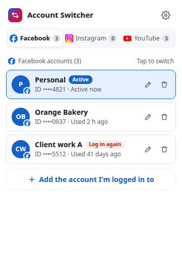

# Social Account Switcher

Switch between your own Facebook, Instagram and YouTube accounts from a Chrome extension popup. Log in on each website yourself; the extension saves a session you can return to later.



Version 0.1.0 is in development and has not been published. The screenshot uses fictional accounts. Live account checks and the final privacy review are still required before a release.

Facebook and Instagram sessions are encrypted on this device with a master password. YouTube uses Google's multi-account sign-in with a saved account index and optional channel ID; it does not replace Google cookies. There is no extension server, analytics or remote code. Account labels and identifiers are stored locally without encryption. See [PRIVACY.md](PRIVACY.md) for the privacy policy and [SECURITY.md](SECURITY.md) for reporting a vulnerability.

Facebook and Instagram are trademarks of Meta Platforms, Inc.; YouTube is a trademark of Google LLC. The marks are not covered by this project’s MIT license. See [logo sources](public/brands/SOURCES.md). This project is not affiliated with, endorsed by or sponsored by Meta or Google.

## Install

Requires Chrome 119 or newer, as declared in the manifest. Automated browser tests use Playwright's bundled Chromium.

When a release is available, download `social-account-switcher-v<version>.zip` from this repository's Releases page. Unzip it, open `chrome://extensions`, enable **Developer mode**, choose **Load unpacked**, and select the folder containing `manifest.json`. Keep that folder in place.

To try the development version, follow the build steps below and load `dist/` instead.

## Use

1. Open the popup and set a master password on first use. Sign in to an account on the website yourself, including any verification steps.
2. Select its platform in the popup and choose **Add the account I'm logged in to**. Give it a label you will recognize. Repeat for your other accounts.
3. Choose a saved account to switch. Unlock the vault when asked. Use **Update session** after signing in again if a saved session expires; use the edit or delete button beside an account to rename or remove it.

YouTube entries use accounts already signed in through Google. The popup still asks you to unlock when the vault is locked.

## Limits and risks

- Saved session cookies can grant account access. Use a strong, unique master password: someone who copies your browser profile can try to guess it offline. The password is not stored, and there is no recovery. Resetting the vault deletes its saved data.
- Logging out on a website can invalidate its saved session. A platform may also require another login or a checkpoint. Complete those steps yourself, then update the saved session.
- Removing a saved entry does not log that account out of the website. Lock the vault when you finish, and protect your browser profile and device.
- YouTube account indexes can change after logout. Switching checks the resulting account and reports a mismatch. If another YouTube navigation completes just before sign-in finishes, verification can report an expired session; sign in again and choose **Update session**.
- Use accounts you own and follow each platform's terms. This extension does not bypass login, two-factor authentication or platform restrictions. Real-account YouTube behavior still needs the manual release checks in the [design](docs/design.md).

## Develop

Install the Bun version pinned by `packageManager` in `package.json`, then run:

```bash
bun install --frozen-lockfile
bun run build
bun run check
bunx playwright install chromium
bun run e2e
```

Load `dist/` as an unpacked extension. `bun run dev` rebuilds it as files change; reload the extension after a build.

| Command | Purpose |
|---|---|
| `bun run check` | Strict TypeScript, lint and browser API boundaries, unit tests with coverage, build and permission checks |
| `bun run e2e` | Browser tests using an unpacked extension and local fixtures |
| `bun run icons` | Render the composite SVG to 16, 32, 48 and 128 px PNGs and a light/dark preview |
| `bun run screenshots` | Render sample popup screenshots without contacting platform websites |
| `bun run zip` | Build and check a deterministic release zip and SHA-256 file |
| `bun outdated` | Check dependency freshness; it should have no entries before integration |

The image scripts use the existing Playwright Chromium installation. README images show fictional data from the popup test fixture. The generic encryption footer is omitted because account metadata is unencrypted. They are illustrative screenshots, not evidence of a live account switch.

### Project layout

```text
assets/icon.svg             composite icon referencing the supplied platform marks
src/background/            service worker, platform switching and browser adapter
src/lib/                   storage, encryption, messages and browser API interfaces
src/popup/                 popup UI and runtime adapter
public/_locales/{en,th}/    English and Thai messages
public/icons/              generated extension icons
tests/unit/                unit tests and coverage
tests/e2e/                 unpacked-extension browser tests and popup fixtures
scripts/                   checks, image generation and release packaging
docs/design.md             design, threat model and manual release checks
docs/images/               generated popup screenshots and icon preview
```

Browser APIs enter through interfaces in `src/lib/ports.ts`. Only the background and popup adapters access the browser global. Lint and packaging checks reject direct network calls and remote code; reviewers must also inspect changes because static checks cannot detect every indirect call. No runtime dependencies ship with the extension.

### Add a language

Copy `public/_locales/en/messages.json` into a new locale directory and translate the message values, preserving keys and placeholders. Add the locale to the `Language` type and language resolver/catalog, and add its choice to the popup settings. Run the locale key/placeholder tests, the full checks and browser tests. Extend the screenshot script if images in that language are needed; adding a directory alone does not add a settings choice.

## Release

1. Finish the manual release checks in [docs/design.md](docs/design.md), including live account verification and privacy review. Update `version` in `package.json` and move the relevant changelog entries into a versioned section.
2. Run the CI checks and `bun run zip`. Inspect the zip, its icons and the unpacked popup.
3. Commit, tag `v<version>` and push the tag. The Release workflow checks the tag/version match, runs checks and attaches the zip and checksum to a repository release.
4. Share the GitHub Release zip and checksum. Distribution is through GitHub Releases.

## License

[MIT](LICENSE)
